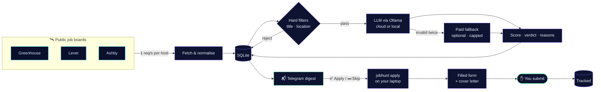

<div align="center">



<br/>

**Finds the jobs. Reads every description. Tells you which ones are worth your time.**<br/>
**Discovery runs daily in the cloud (or on your machine). Applying is assisted: you press Submit.**

<br/>

[](https://github.com/S-T-R-A-N-G-E-R/jobhunt/actions/workflows/ci.yml)
[](https://www.python.org/)
[](https://docs.astral.sh/uv/)
[](https://ollama.com)
[](https://playwright.dev/python/)
[](LICENSE)

[**Quickstart**](#-quickstart) · [**How it works**](#-how-it-works) · [**Docs**](#-documentation) · [**Roadmap**](#-roadmap)

</div>

<br/>

## ⟢ Why this exists

Job hunting while employed is a slow grind: open ten career pages, scroll past three hundred roles, read forty descriptions, and realise two of them were worth it. Do that daily for weeks. For a lot of people, especially anyone for whom repetitive tasks are a real wall, the search quietly stops after a few days.

**jobhunt turns that grind into a ten-minute review.** Every morning a scheduled run (GitHub Actions, or your own machine) pulls fresh openings from the companies you care about, throws out the obvious misses, has an LLM read the rest against your resume and preferences, and drops a ranked digest into Telegram with an Apply / Skip button on every job.

Tap Apply, and later `jobhunt apply` opens each form on your laptop, fills it from your answer bank, attaches your resume and a tailored cover letter, and stops. You review it and press Submit. It never submits on its own.

<br/>

<table>
<tr>
<td width="50%" valign="top">

### 🛰️ Daily discovery
Polls the **official public job-board APIs** of Greenhouse, Lever and Ashby, twice a day on **GitHub Actions** from a private repo, or on your own machine. No scraping, no logins, idempotent re-runs.

### 🧠 Scoring, cloud or local
**Ollama Cloud** (`gpt-oss:20b`) in the cloud run, or a **local model via Ollama** on your machine, with schema-constrained JSON and guardrails in code. An optional paid fallback is capped and counted.

### 🧗 Stretch roles
Jobs that fit everything but your level aren't silently dropped: a few show up in a clearly labelled section with the score they'd have had.

</td>
<td width="50%" valign="top">

### 📬 Telegram digest
One card per match (score, pitch, top reason, red flags) with **✅ Apply / ⏭ Skip** buttons. One ping per digest, and quiet days still get a heartbeat.

### ✍️ Assisted applying
`jobhunt apply` fills the form in a visible browser, attaches a tailored, claim-checked cover letter, highlights anything uncertain, and waits. **You press Submit.**

### 🔒 Private by default
Your profile, resume, answers, companies and databases are git-ignored; the cloud runs from a private repo. Pay, contact, authorization and EEO answers never reach an LLM. Ollama Cloud and the paid fallback see only your resume, profile, chosen facts and the job.

</td>
</tr>
</table>

<br/>

## ⟢ What lands on your phone

<div align="center">

<br/>
<sub>Illustration with fictional companies. Real digests use your scores, your filters, your boards.</sub>
</div>

<br/>

## ⟢ How it works



| Stage | What happens | Cost |
|:--|:--|:--|
| **01 · Fetch** | Pulls every open role from your listed boards and normalises it into one job model. A broken board is reported, never fatal. | free |
| **02 · Filter** | Phrase-level title matching, excluded keywords, location and remote rules. Thousands of jobs become a few dozen in milliseconds. | free |
| **03 · Score** | The LLM (Ollama Cloud or local) returns a 0–100 score, reasons, red flags and a pitch, validated against a schema. Guardrails in code keep small models honest. | Ollama Cloud credits, or free locally |
| **04 · Digest** | New matches above your threshold, one Telegram card each with Apply / Skip buttons, plus a few stretch roles. Archived as Markdown. | free |
| **05 · Apply** | On your laptop: approved jobs open in a visible browser, filled from your answer bank, with a tailored cover letter. You review, solve any CAPTCHA, and press Submit; the outcome is recorded. | Ollama Cloud credits, or free locally |

> **Guardrails that matter on a small model.** Verdicts are derived from the score in code, so they can never contradict each other. Roles above your seniority are capped. Compensation is reported as unknown, never guessed. See [`docs/DECISIONS.md`](docs/DECISIONS.md) for the reasoning behind each one.

<br/>

## ⟢ Quickstart

> **Requirements:** macOS, Linux or Windows · Python 3.11+ · [uv](https://docs.astral.sh/uv/) · [Ollama](https://ollama.com) · a Telegram account. A GitHub account for the cloud run.

```bash
# 1 · get the code and dependencies
git clone https://github.com/S-T-R-A-N-G-E-R/jobhunt.git
cd jobhunt
uv sync

# 2 · pull the local model (≈4 GB)
ollama pull qwen3.5:4b

# 3 · create your private files (all git-ignored)
cp .env.example .env
cp config/profile.example.yaml config/profile.yaml
cp config/companies.example.yaml config/companies.yaml
uv run jobhunt resume import path/to/resume.pdf

# 4 · add the companies you care about
uv run jobhunt company add https://job-boards.greenhouse.io/<company>
uv run jobhunt company add https://jobs.lever.co/<company>
uv run jobhunt company add https://jobs.ashbyhq.com/<company> --priority high

# 5 · first run, printed instead of sent
uv run jobhunt run --preview
```

Then add your Telegram bot token and chat ID to `.env` and run `uv run jobhunt run`. The full walkthrough is in **[docs/SETUP.md](docs/SETUP.md)**.

- **Run it daily in the cloud** → [docs/CLOUD.md](docs/CLOUD.md) (or locally with `jobhunt schedule install` on macOS, cron elsewhere)
- **Apply with assisted filling** → [docs/APPLY.md](docs/APPLY.md)

<details>
<summary><b>🎛️ What goes in <code>profile.yaml</code></b></summary>

<br/>

```yaml
target_titles: ["Senior Backend Engineer", "Platform Engineer"]
title_exclude_keywords: ["intern", "internship", "sales"]
seniority: senior
years_experience: 6
locations:
  accept: ["Bengaluru", "Remote - India", "Remote"]
  remote_ok: true
  relocation_ok: false
  relocation_cities: []
  relocation_notes: ""
compensation:
  current_ctc_lpa: 0
  min_expected_ctc_lpa: 0
  min_usd_remote: 0
must_haves: ["backend ownership", "Python or Go"]
nice_to_haves: ["open-source work"]
dealbreakers: ["contract only", "pure frontend"]
what_i_want: |
  A few honest sentences about the next role you want. The scoring leans on this.
```

Specific titles beat broad ones: titles match as phrases with seniority words ignored, so `"Staff Engineer"` matches every "… Engineer" title, while `"Senior Backend Engineer"` matches what you mean. The file also has `llm`, `scoring` and `digest` sections; the defaults are fine to start with ([USAGE.md](docs/USAGE.md#useful-settings-in-profileyaml)).

</details>

<br/>

## ⟢ Everyday commands

| Command | |
|:--|:--|
| `jobhunt apply` | Pull the cloud DB, read your button presses, fill each approved form; you press Submit |
| `jobhunt apply pick` | Decide on digest jobs in the terminal: apply, skip, later |
| `jobhunt apply status` | Applications by date and this week's count |
| `jobhunt apply prepare <id>` | Draft answers (and a letter, with `--letter`) without filling |
| `jobhunt cloud run` | Start the cloud run now (`--force` to rerun today) |
| `jobhunt cloud pull-db` | Bring the cloud's DB to the laptop for `top` / `status` |
| `jobhunt cloud push-secrets` | Upload profile, resume, companies and keys after editing them |
| `jobhunt top --n 20` | Best current matches, as a table |
| `jobhunt status` | Last run, unscored backlog, stale scores |
| `jobhunt score --rescore` | Re-score after changing your profile or the prompt |
| `jobhunt llm test` | Check Ollama (and the fallback, if configured) |
| `jobhunt schedule install` | Run daily on your Mac instead of the cloud |

Prefix with `uv run`. Everything else is in **[docs/USAGE.md](docs/USAGE.md)**.

<br/>

## ⟢ Built with

<div align="center">

| | | | |
|:--:|:--:|:--:|:--:|
| **Python 3.11+** | **uv** | **httpx** | **pydantic v2** |
| **Typer + Rich** | **SQLite** | **Ollama** | **Telegram Bot API** |
| **Playwright** | **GitHub Actions** | **pypdf** | **pytest** |

</div>

```
jobhunt/
├── src/jobhunt/
│   ├── sources/        greenhouse · lever · ashby fetchers
│   ├── llm/            ollama (local or cloud) · anthropic (fallback)
│   ├── prompts/        score_job.md · cover_letter.md · check_claims.md · answer_question.md
│   ├── apply/          session · form filler + submit guard · store · greenhouse/lever/ashby adapters
│   ├── scoring.py      hard filters + LLM loop
│   ├── digest.py       Telegram digest with Apply / Skip buttons
│   ├── decisions.py    reads button presses
│   ├── answers.py      answer bank + question rules
│   ├── materials.py    cover letter + drafted answers
│   ├── pipeline.py     fetch → score → digest
│   ├── db.py           SQLite storage + migrations
│   ├── cli.py          the jobhunt command
│   ├── schedule.py     macOS launchd schedule
│   └── cloud.py        GitHub Actions runner helpers
├── deploy/             workflow for a private GitHub Actions runner repo
├── config/             *.example.yaml (your real files are git-ignored)
├── docs/               setup, usage, cloud, apply, architecture, decisions, troubleshooting
└── tests/              offline tests with synthetic fixtures
```

<br/>

## ⟢ Principles

<table>
<tr>
<td>🚫</td><td><b>No scraping of LinkedIn, Naukri, Indeed or Glassdoor.</b> Their terms forbid it, and your account is your professional identity.</td>
</tr>
<tr>
<td>🤝</td><td><b>Polite to every API.</b> Official public endpoints only, 1 request/second per host, identified User-Agent, backoff on errors.</td>
</tr>
<tr>
<td>✋</td><td><b>You press Submit, always.</b> It fills the form in a visible browser and stops; a guard blocks any submit while it fills.</td>
</tr>
<tr>
<td>🧩</td><td><b>Never bypasses CAPTCHAs.</b> No solvers, no disguised browser. If a challenge appears, you solve it.</td>
</tr>
<tr>
<td>📄</td><td><b>Never invents facts about you.</b> Letters and answers use only your profile, answer bank and resume; anything uncertain is left empty and highlighted.</td>
</tr>
<tr>
<td>🏠</td><td><b>Local first, honestly.</b> A local model can do everything. Ollama Cloud is the cloud run's default and one setting turns it off. Paid models are a capped, visible fallback, never a silent default.</td>
</tr>
</table>

<br/>

## ⟢ Roadmap

- [x] **Phase 1 · Discover:** public-board fetching, hard filters, LLM scoring, Telegram digest, daily cloud or local runs
- [x] **Phase 3 · Draft:** tailored, claim-checked cover letters and an answer bank for common form questions
- [x] **Phase 4 · Assist:** browser filling for Greenhouse, Lever and Ashby, with Apply / Skip buttons and tracking; you review and click Submit ([docs/APPLY.md](docs/APPLY.md))
- [ ] **Phase 2 · Inbox** (next): parse job-alert emails from the big boards
- [ ] **Later · Phone-friendly apply mode:** the bot sends the tailored cover letter and answers to copy when you tap ✅

<br/>

## ⟢ Documentation

| | |
|:--|:--|
| 🚀 [**Setup**](docs/SETUP.md) | Install, Ollama, Telegram bot, companies, schedule |
| 🧭 [**Usage**](docs/USAGE.md) | Daily commands, rescoring, prompt tuning, paid fallback |
| ☁️ [**Cloud**](docs/CLOUD.md) | Run discovery daily on GitHub Actions from a private repo |
| ✍️ [**Apply**](docs/APPLY.md) | Answer bank, cover letters, assisted filling, what's filled from where |
| 🏗️ [**Architecture**](docs/ARCHITECTURE.md) | Modules, both databases, Telegram decisions, LLM routing |
| 🧪 [**Decisions**](docs/DECISIONS.md) | Why things work the way they do, and known limits |
| 🩺 [**Troubleshooting**](docs/TROUBLESHOOTING.md) | When a run, a board, Ollama or a form misbehaves |

<br/>

## ⟢ Development

```bash
uv run playwright install chromium   # once, for the form-filling tests
uv run pytest                 # fully offline: synthetic board fixtures, mocked LLMs and Telegram, local form pages
uv run ruff check src tests
```

Issues and pull requests are welcome. Please keep tests offline and personal data out of fixtures.

<br/>

## ⟢ License

[MIT](LICENSE) © S-T-R-A-N-G-E-R

<br/>

<div align="center">
<sub>Built so the search keeps going on the days you can't.</sub>
</div>
